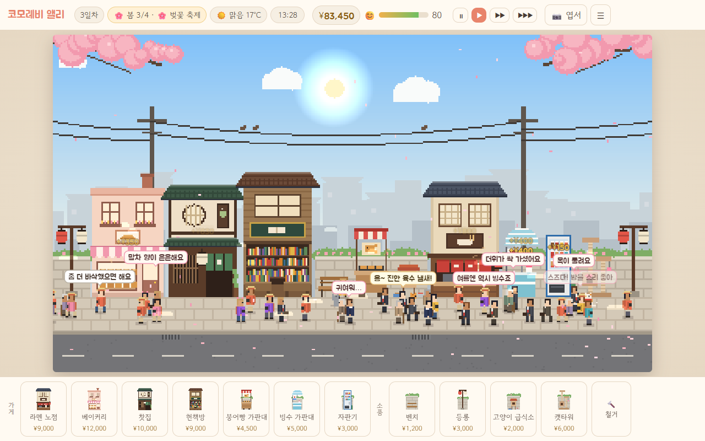
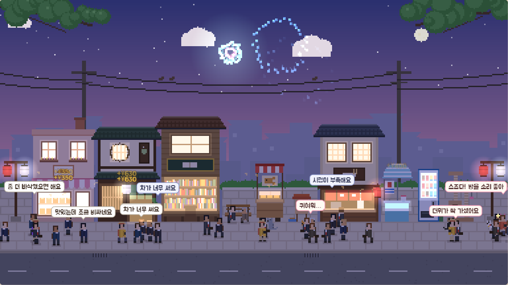
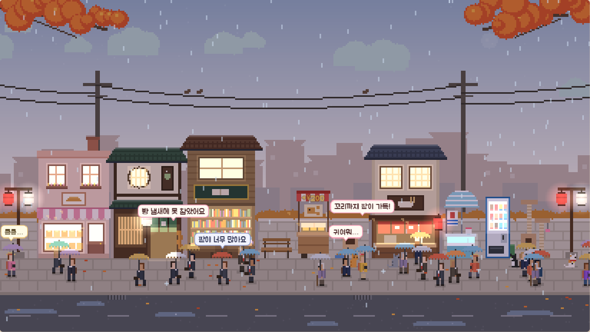
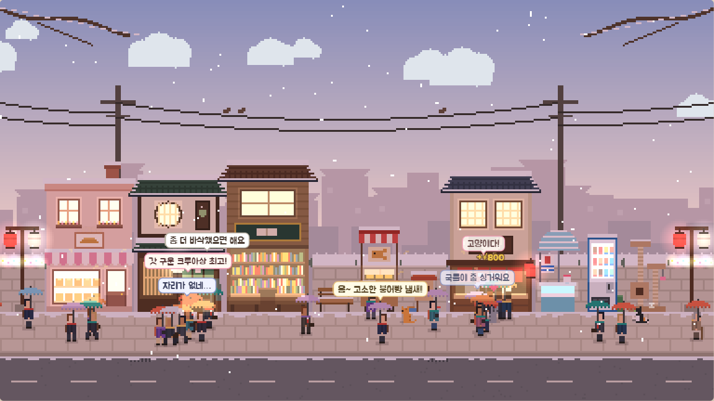
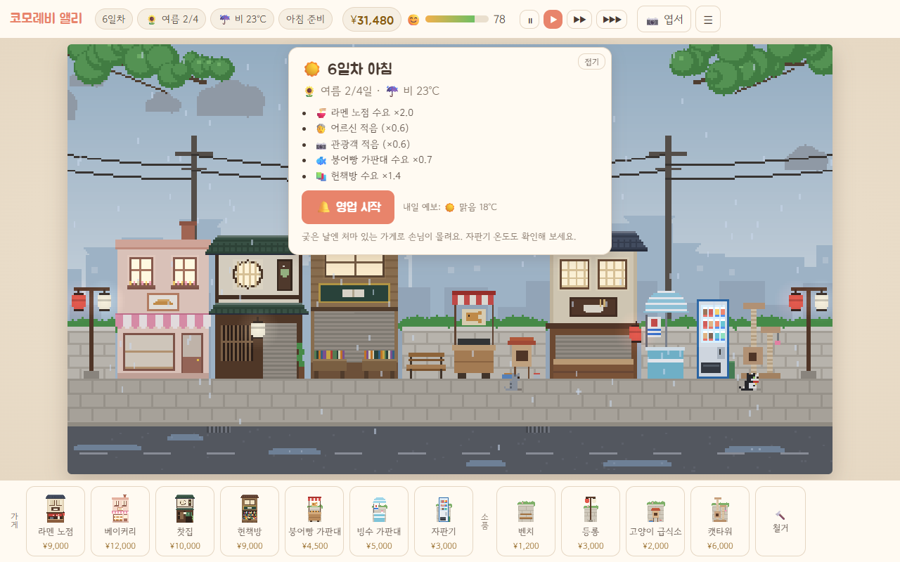
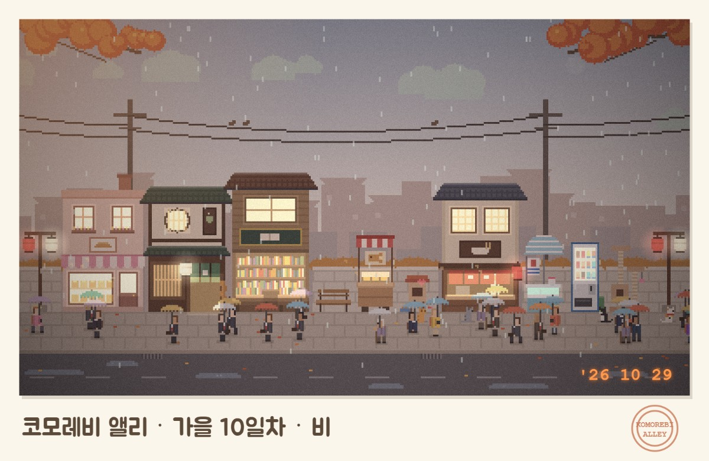

<div align="center">


# 코모레비 앨리 · Komorebi Alley

**날씨와 계절, 가게 냄새와 길고양이로 손님 흐름을 읽는 작은 골목 경영 시뮬레이션**

<sub>코모레비(木漏れ日) — 나뭇잎 사이로 비치는 햇살</sub>

<br>

[](https://jeiel85.github.io/komorebi-alley/)

[](https://github.com/jeiel85/komorebi-alley/actions/workflows/deploy.yml)


[](LICENSE)

<br>

<a href="https://jeiel85.github.io/komorebi-alley/"></a>

</div>

<br>

아침에 날씨 예보를 보고 골목에 가게를 짓고, 낮에는 손님들의 솔직한 한마디를 들으며 맛과 가격을 다듬고, 저녁에 하루를 결산합니다. 비가 오면 라멘 노점에 줄이 서고, 빵 굽는 냄새는 지나가던 사람을 되돌려 세우고, 급식소 옆에는 길고양이가 하나둘 자리를 잡습니다.

휴대폰 브라우저에서도 돌아가고, 진행 상황은 브라우저에 자동 저장됩니다.

## 사계절의 골목

<table>
  <tr>
    <td width="33%"></td>
    <td width="33%"></td>
    <td width="33%"></td>
  </tr>
  <tr>
    <td align="center"><b>여름 · 불꽃놀이 축제</b><br><sub>저녁엔 손님이 크게 늘고 밤하늘에 불꽃이 터진다</sub></td>
    <td align="center"><b>가을 · 비 오는 저녁</b><br><sub>처마 있는 가게와 라멘 노점에 손님이 몰린다</sub></td>
    <td align="center"><b>겨울 · 눈 오는 저녁</b><br><sub>겨울엔 등롱 효과가 두 배가 된다</sub></td>
  </tr>
</table>

## 무엇을 하나요

<table>
  <tr>
    <td width="50%"></td>
    <td width="50%">

**🌦️ 아침 · 예보를 읽고 준비하기**<br>
오늘 날씨와 축제, 손님층과 가게별 수요 변화가 예보 카드에 뜹니다. 가게를 짓고 옮기고, 맛 슬라이더와 가격을 고칩니다.

**🏮 낮 · 손님의 한마디 듣기 (10:00~20:00)**<br>
학생·직장인·어르신·관광객이 저마다 다른 입맛과 지갑으로 지나갑니다. “팥이 너무 적어요”는 맛 신호, “조금 비싸네요”는 가격 신호입니다.

**📒 저녁 · 결산**<br>
가게별 손님 수·매출·만족도와 가장 많이 들은 말, 냄새에 이끌려 되돌아온 손님 수를 보고 다음 날을 준비합니다.

</td>
  </tr>
</table>

## 핵심 시스템

| 시스템 | 무엇이 달라지나 |
| :--- | :--- |
| 🍂&nbsp;**사계절과&nbsp;날씨** | 계절마다 4일, 16일이 1년입니다. 날씨는 맑음·흐림·비·눈·폭염 5가지이고 계절마다 축제가 하루 있습니다(벚꽃 축제·불꽃놀이·단풍 축제·일루미네이션). 기온에 따라 손님 입맛도 움직여서, 자판기 온도나 라멘 국물 진하기의 정답이 날마다 달라집니다. |
| 🍞&nbsp;**냄새가&nbsp;퍼지는&nbsp;거리** | 빵집 냄새는 3칸까지 퍼져 들를 확률을 최대 40% 올립니다. 그냥 지나친 손님이 냄새를 맡고 되돌아오기도 합니다. 냄새가 닿는 범위는 화면에 냄새 입자로 보입니다. |
| 🏘️&nbsp;**이웃&nbsp;시너지** | 붙여 지으면 생기는 효과가 7가지(좋은 것 5, 나쁜 것 2) 있습니다. 헌책방과 찻집이 붙으면 손님이 두 배로 오래 머물고, 라멘 냄새는 찻집 손님이 싫어합니다. 짓기 전에 미리보기로 확인할 수 있습니다. |
| 🐈&nbsp;**골목&nbsp;고양이** | 급식소와 캣타워를 두면 길고양이가 찾아옵니다(품종 5가지 · 성격 4가지). 손님도 플레이어도 쓰다듬을 수 있고, 조건을 채우면 방울 단 삼색이 ‘스즈’가 골목 마스코트가 되어 관광객을 불러옵니다. |
| 📷&nbsp;**빈티지&nbsp;엽서** | 지금 장면을 빛바랜 필름 느낌의 엽서 PNG로 저장합니다. 날짜 각인과 소인도 찍힙니다. |

<p align="center">
  
</p>

## 조작

| 동작 | 마우스·키보드 | 터치 |
| :--- | :--- | :--- |
| 건설 | 팔레트에서 고른 뒤 클릭 | 같은 자리를 두 번 탭 |
| 취소 | 우클릭 · `Esc` | 고른 항목을 팔레트에서 다시 탭 |
| 가게 조절 | 가게 클릭 → 맛 슬라이더·가격 | 가게 탭 |
| 일시정지 · 속도 | `Space` · `1` `2` `3` | 상단 버튼 |
| 엽서 | `P` | 📷 엽서 버튼 |
| 고양이 쓰다듬기 | 고양이 클릭 | 고양이 탭 |

## 이 프로토타입이 확인하려는 것

기능 목록을 채우려는 것이 아니라, 아래 세 가지가 실제로 재미를 만드는지 플레이테스트로 확인하려고 만들었습니다.

1. 아침 날씨 예보가 **배치와 슬라이더 결정을 실제로 바꾸는가** (비 오는 날 라멘, 폭염에 빙수와 차가운 자판기)
2. 냄새 반경과 이웃 시너지가 **배치 퍼즐로 읽히는가** (냄새 입자, 건설 미리보기의 시너지 표시, 결산의 “냄새에 이끌려 되돌아온 손님”)
3. 길고양이가 **다음 날을 여는 이유**가 되는가

해 보시고 느낀 점은 [이슈](https://github.com/jeiel85/komorebi-alley/issues)로 남겨 주세요.

## 로컬에서 실행

Node 24 이상이 필요합니다(밸런스 스크립트가 Node의 TypeScript 직접 실행을 씁니다).

```bash
npm install
npm run dev        # 개발 서버 http://localhost:5173
npm test           # 시뮬레이션 단위 테스트(Vitest)
npm run build      # 타입 검사 + 정적 빌드(dist/)
npm run balance    # 헤드리스 밸런스 시뮬레이션(시드 20개 평균)
```

`main`에 푸시하면 GitHub Actions가 테스트와 빌드를 거쳐 [GitHub Pages](https://jeiel85.github.io/komorebi-alley/)에 배포합니다([`deploy.yml`](.github/workflows/deploy.yml)).

<details>
<summary><b>프로젝트 구조</b></summary>

```
src/sim/     순수 시뮬레이션(브라우저 API 없음, Node에서 테스트)
  data.ts      밸런스 수치·정적 정의(건물, 계절, 날씨, 주민, 시너지, 목표)
  game.ts      게임 상태와 하루 FSM, 보행자·고양이 갱신
  economy.ts   방문 확률, 지불 의향, 구매 평가와 말풍선
  street.ts    배치·확장·시너지 / aroma.ts 냄새 / weather.ts 계절·날씨 / cats.ts 고양이
  save.ts      저장 포맷 v1 직렬화와 검증
src/render/  절차적 픽셀 아트(외부 이미지 없음), 시간대 조명, 날씨·냄새 입자, 엽서
src/ui/      HUD, 건설 팔레트, 가게 패널, 결산·메뉴 모달, 브라우저 저장
tests/       Vitest
scripts/balance.ts  밸런스 점검
```

- 건물·사람·고양이·하늘은 모두 코드로 그립니다. 외부 이미지 파일이 없고, 런타임 의존성도 없습니다.
- 시뮬레이션은 시드 고정 난수 하나로만 돌아서, 같은 시드·같은 입력이면 같은 하루가 나옵니다.
- 저장: 매일 아침(준비 단계)과 아침에 건설·조절할 때 브라우저 `localStorage`에 자동 저장합니다. 영업 중에 닫으면 그날 아침으로 돌아갑니다. 저장 데이터가 손상되면 지우지 않고 `komorebi-alley/save/v1.broken-<시각>` 키로 옮겨 둔 뒤 새 게임으로 시작합니다. 메뉴에서 저장 파일(JSON)로 내보내고 불러올 수 있습니다.
- 처리되지 않은 오류가 나면 게임을 멈추고 안내 화면을 띄웁니다. 오류 내용 복사, 저장 파일 받기, 이슈 링크가 들어 있습니다. 예외 뒤의 상태는 믿을 수 없어서 계속 돌리지 않습니다.
- 공유 미리보기(og)와 이슈 링크 주소의 기본값은 [`.env`](.env)에 있고, Actions 배포에서는 실제 Pages 주소와 저장소로 덮어씁니다.
- 개발 서버에서만 콘솔에 `window.komorebi`(`ui`, `renderer`) 점검용 핸들이 열립니다. 프로덕션 빌드에는 들어가지 않습니다.
- 글꼴은 Google Fonts(Jua, Gowun Dodum)를 쓰고, 오프라인이면 시스템 한글 글꼴로 대체됩니다.

</details>

<details>
<summary><b>설계서 대비 구현 범위</b></summary>

설계서 `Komorebi Alley: Micro-Economy Cozy Street Architect` v1.0.0의 MVP 1~4주 범위를 먼저 만들었습니다.

| 설계서 항목 | 이 프로토타입 | 비고 |
| :--- | :--- | :--- |
| 하루 FSM (MorningPrep → DaytimeBusinessRush → EveningSunsetAccounting → SeasonalShiftFestival) | 준비 → 영업 → 결산 → 다음 날(계절 전환 배너) | `src/sim/game.ts` |
| WeatherAdaptiveMenu | 아침 예보 카드 + 기온에 따라 선호가 움직이는 슬라이더(자판기 온도, 라멘 진하기) | |
| 동적 사계절·날씨 유동인구 | 계절 4일씩 16일 1년, 날씨 5종, 계절마다 축제 1일 | 비 오는 날 라멘 매출 약 1.8배(설계서 “200%”에 맞춤) |
| 향기 확산·공간 시너지 | 냄새 반경 안에서 방문 확률 최대 +40%, 지나친 손님이 냄새에 이끌려 되돌아옴, 인접 시너지 7종(긍정 5·부정 2) | 냄새 입자로 반경이 보임 |
| 길고양이 쉼터·마스코트 | 급식소·캣타워, 품종 5·성격 4, 손님/플레이어 쓰다듬기, 전설의 고양이 ‘스즈’ 마스코트와 관광객 팬 유입 | |
| 커스텀 골목·공유 | 골목 저장 파일(JSON) 내보내기/불러오기 | 스팀 창작마당 연동은 없음 |
| 빈티지 엽서 | 로파이 필터·날짜 각인·소인이 들어간 PNG 저장 | |
| FMOD 오디오, Steam/Switch 최적화 | 없음 | [BACKLOG.md](BACKLOG.md) |

엔진을 Godot·Unity 대신 웹으로 정한 이유와 설계서와 다르게 정한 부분은 [DECISIONS.md](DECISIONS.md)에 있습니다.

</details>

## 알려진 한계

- 중반이 넘어가면 돈이 남습니다(가게 9곳이면 하루 매출이 총 건설비와 비슷). 콘텐츠 볼륨 문제를 아직 풀지 않았습니다.
- 소리가 없습니다.
- 손님은 한 줄 보도 위를 왼쪽·오른쪽으로만 걷습니다.

다음 작업 후보는 [BACKLOG.md](BACKLOG.md)에 있습니다.

## 라이선스

[MIT](LICENSE). 코드와, 코드로 그리는 픽셀 아트 모두에 적용됩니다. 글꼴(Jua, Gowun Dodum)은 저장소에 들어 있지 않고 Google Fonts에서 불러오며, 각 글꼴의 라이선스(SIL Open Font License)를 따릅니다.
